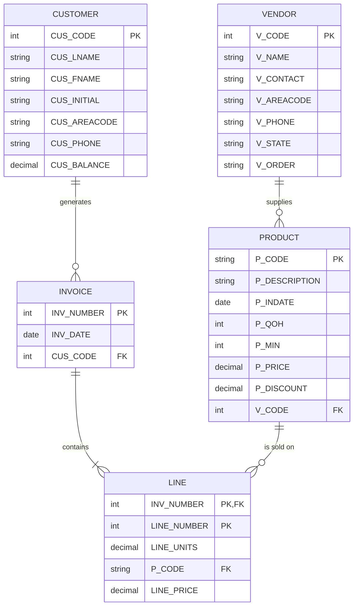

# SaleCo entity relationship diagram

Source: [`Entity Relationship Diagram.pdf`](../Entity%20Relationship%20Diagram.pdf) (4 pages). The PDF contains a Crow's Foot ERD (an image) plus written answers listing entities, attributes, relationships, keys, and the eight business rules the diagram encodes. The diagram below was transcribed from the image and cross-checked against the written answers and against the SaleCo DDL in [`sql/rdb/build-saleco-schema.sql`](../sql/rdb/build-saleco-schema.sql).

## Diagram

## Entities and attributes (from the written answer)

| Entity | Attributes | Primary key | Foreign keys |
|--------|-----------|-------------|--------------|
| Customer | cus_code, cus_lname, cus_fname, cus_initial, cus_areacode, cus_phone, cus_balance | `CUS_CODE` | none |
| Invoice | inv_number, inv_date, cus_code | `INV_NUMBER` | `CUS_CODE` references `CUSTOMER.CUS_CODE` |
| Line | inv_number, line_number, line_units, p_code, line_price (assumed equal to p_price minus p_discount) | composite (`INV_NUMBER`, `LINE_NUMBER`) | `P_CODE` references `PRODUCT.P_CODE` (and `INV_NUMBER` references `INVOICE`, see note) |
| Product | p_code, p_description, p_indate, p_qoh (quantity on hand), p_min (reorder floor), p_price, p_discount, v_code | `P_CODE` | `V_CODE` references `VENDOR.V_CODE` |
| Vendor | v_code, v_name, v_contact, v_areacode, v_phone, v_state, v_order (Y/N flag: vendor previously used) | `V_CODE` | none |

`LINE_NUMBER` only positions a line within its invoice (1, 2, 3, ...), which is why it is not a key on its own and the line is identified by the invoice number plus line number.

## Relationships and cardinalities

| # (in ERD) | Relationship | Cardinality |
|------------|--------------|-------------|
| 1, 2 | Customer to Invoice | one and only one customer : zero or many invoices |
| 3, 4 | Invoice to Line | one and only one invoice : one or many lines |
| 5, 6 | Product to Line | one and only one product : zero or many lines |
| 7, 8 | Vendor to Product | one vendor : zero or many products |

## Business rules (as submitted)

1. Every customer can have zero or more invoices.
2. Zero or many invoices are generated for a customer.
3. Every invoice can have one or many lines.
4. One or many lines can be generated for an invoice.
5. Zero or many lines can belong to one product.
6. One product can have zero or many lines.
7. Zero or many products are supplied by a vendor.
8. One vendor supplies zero or many products.

## Notes from comparing the ERD with the DDL

- The written answer lists only `P_CODE` as the foreign key on `LINE`. `INV_NUMBER` is both part of the composite primary key and a foreign key to `INVOICE`, and the DDL declares it that way (`FOREIGN KEY (INV_NUMBER) REFERENCES INVOICE (INV_NUMBER) ON DELETE CASCADE`).
- The ERD draws the vendor side of relationship 7/8 as mandatory, but the DDL leaves `PRODUCT.V_CODE` nullable, so a product without a vendor is allowed in the physical schema. The BI query `WHERE V_CODE IS NULL` in `sql/rdb/sample-queries.sql` relies on that.
- The ERD labels the product description `P_DESCRIPTION`; the DDL names the column `P_DESCRIPT`.
- The DDL adds two constraints the ERD does not show: `UNIQUE (CUS_LNAME, CUS_FNAME)` on `CUSTOMER` and `UNIQUE (INV_NUMBER, P_CODE)` on `LINE` (a product appears at most once per invoice).
